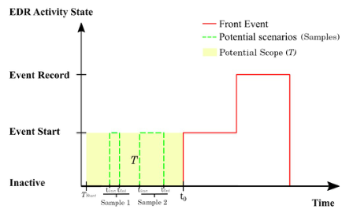

 Evolutionary Algorithm for EDR test samples

### Introduction
This algorithm was presented as a part in the thesis I wrote for my Master of Science (M.Sc.) degree in the “Automotive Software Engineering” program, whose main objective was to provide a testing methodology based on the ISO 26262 standard to address the new regulations taking effect in 2021 for EDRs and DSSADs within the framework of several markets around the world.  EDR (Event Data Recorder) and DSSAD (Data Storage System for Automated Driving) are devices installed in vehicles to record critical driving and crash dynamics data during an accident.

The proposed approach to create test samples assumes the discovery of a malfunction during a test.  Thereafter, it can be used to exploit the flaw, uncovering other related malfunctions, and narrowing down the scope and behavior of the error within the limits of the HiL test.

In this implementation a run starts with no known error ($E = \varnothing$) unless failures are entered before it starts: the **EA** explores until the HiL reports a first failure, then exploits it. $E$ is interactive: besides the HiL verdicts, failures can be added by the user, yet a failure cannot be removed.

### Description
In the operation of an EDR, there are different thresholds for activating and recording an event, these are defined in government resolutions.  The test under consideration examines whether reaching just the activation threshold (the so-called "Trivial Event") might prevent the recording of an event.

If some errors are detected during a HiL test cycle for the case described above, the parameters of further tests can be optimized by this Evolutionary Algorithm (hereinafter referred to simply by the acronym **EA**).  The `WebApp` uses the **EA**. In this way, it is possible to simulate the **EA**’s cycle within the HiL test and obtain a visual representation of what the algorithm does.



*EDR test case for which the **EA** is made*

#### Population

A test set for this test case (**EA**'s output) is a collection of tuples setting the start and the end of the so called "trivial event" in the way
$$(t_{\text{start}}, t_{\text{end}})$$
where
* $t_{\text{end}} - t_{\text{start}} \ge d_{\min}$ (a minimum duration; zero-length events are never produced). $t_{\text{end}}$ is meant to lie in $T$ (soft, see $V_2$).
* $t_{\text{start}}$ may lie before $T_{\text{Start}}$: only $t_{\text{end}}$ is required to be inside $T$, and it is only *penalised* (not forbidden) for lying outside it, by $V_2$ below.
* $T = [T_{\text{Start}}, t_0]$: Pre-crash recording time established in the regulation. $t_0$ is the instant when the recording algorithm starts, normally set to zero.
* Candidate tuples are kept inside $[T_{\text{Start}} - \text{offset},\ t_0 + \text{offset}]$, so `offset` bounds how far a search can drift from the test case, not just the fresh tuples of Step 1.
* **Fresh tuples** (Step 1, random immigrants and the exploration pool) come from one 2-D **Halton sequence** per run (bases 2 and 3). It is a low-discrepancy sequence: each new point falls into the gaps left by the earlier ones, so a set of its points covers the domain more evenly than independent random draws. It is shifted at random once per run (drawn from the run's generator, so a seed reproduces it), mapped onto the triangle $t_{\text{start}} \le t_{\text{end}}$ of the domain without distorting the density, and continued across the cycles of the run.

All times are given in milliseconds (*ms*).

#### Fitness Orientation

The optimization made by the **EA** works according to two software testing principles ($V_1$ and $V_3$) and one constraint specific to this case ($V_2$):
* **Defect clustering** ($V_1$): most software bugs are concentrated within a small number of complex or heavily used modules, so the search is attracted towards known errors.
* **Staying within the regulation window** ($V_2$): the main purpose of the HiL test is to verify the EDR within the pre-crash recording time $T$, so $t_{\text{end}}$ outside $T$ is penalised.
* **The Pesticide Paradox** ($V_3$): repeatedly running the same tests will eventually stop finding new bugs, so the search is repelled from everything already tested — this is what keeps the EA exploring instead of only re-testing known failures.

Let $|T| = t_0 - T_{\text{Start}}$ (5000 ms by default). For a tuple $x=(t_{\text{start}}, t_{\text{end}})$:

$$f(x) = V_1(x) + \gamma \cdot V_2(x) + \beta \cdot V_3(x), \qquad \text{lower is better}$$

<br>

* $\displaystyle V_1(x) = \frac{(1-w)\cdot\min\limits_{i \in E}\big|t_{\text{start}} - E_i(t_{\text{start}})\big| \;+\; w\cdot\min\limits_{j \in E}\big|t_{\text{end}} - E_j(t_{\text{end}})\big|}{|T|}$
  * $E$: set of test tuples that have led to an error (error_hit_set). $V_1 = 0$ if $E$ is empty.
  * $t_{\text{start}}$ and $t_{\text{end}}$ are chosen **independently**: the closest known start time and the closest known end time may come from *different* tuples of $E$, so the algorithm can also search cross-combinations of known start and end times, not only tuples that exactly repeat $E$. A cross-combination that has never been tested gives $V_1 = 0$ (and $V_3 = 0$, see below): that is a genuinely new test, not a re-test.
  * $w \in (0.5, 1)$: $t_{\text{end}}$ is more important than $t_{\text{start}}$, so $w > 0.5$. $w$ is also used, the same way, in the whole-tuple distance $d$ used by $V_3$ below.
* $\displaystyle V_2(x) = \frac{\max(0,\ T_{\text{Start}} - t_{\text{end}},\ t_{\text{end}} - t_0)}{|T|}$
  - $V_2$ is the distance from $t_{\text{end}}$ to the nearest bound of $T$, normalized by $|T|$. It is 0 while $t_{\text{end}} \in T$.
  - It is a **soft penalty** on an otherwise unconstrained $t_{\text{start}}$/$t_{\text{end}}$ pair, not a hard constraint.
* $\displaystyle V_3(x) = \max\Big(0,\ 1 - \frac{d(x, y^{\ast})}{r}\Big)$, where $y^{\ast} = \arg\min_{y \in A} d(x, y)$
  * $A$: archive of every tuple tested so far, pass or fail ($E \subset A$). $V_3 = 0$ if $A$ is empty.
  * $\displaystyle d(x, y) = \frac{(1-w)\cdot|x_{\text{start}} - y_{\text{start}}| + w\cdot|x_{\text{end}} - y_{\text{end}}|}{|T|}$: the same weighted distance as $V_1$, but between two **whole tuples** (not per-coordinate). A per-coordinate novelty term would forbid ever reusing a single known start or end time; the whole-tuple distance only forbids reusing both at once.
  * $r$: novelty radius. $V_3$ is highest ($=1$) at distance 0 from a tested tuple and reaches 0 at distance $r$.
* **Ring condition:** because $V_1$ and $V_3$ pull in opposite directions near a known error, the optimum of $f$ sits on a ring of radius $\approx r$ around a tested error only when $\beta > r$. Choose $\beta$ accordingly.
* With $E = \varnothing$ there is nothing to exploit ($V_1 = 0$), and the **EA** works in **coverage mode**: every slot of the test set is an exploration slot (see Test Set Selection), so the tested tuples spread as evenly as possible over the domain until the HiL reports a first failure. Even coverage is the goal of this phase: no large part of the domain stays untested, so a failure region is found as early as the test budget allows. From the first failure on, $f$ balances exploitation (toward $E$) against exploration (away from $A$), and every `explore_every`-th cycle is a **coverage cycle** again, in which the whole test set explores (see Test Set Selection).

The best scored tuple by $f$ is the lowest scored.

#### Variation Drive
The **EA** uses **linear-ranking roulette**: it keeps the "wheel" idea of Roulette Wheel Selection (RWS), but selects by rank instead of by the raw (and scale-dependent) value of $f$, so it stays well-behaved when $f = 0$ or when scores are close together.

Parents are ranked by $f$: rank $0$ is the worst (highest $f$), rank $n-1$ the best (lowest $f$), where $n$ is the size of the parent pool. The parent pool is the **last test set $\cup\ E$**, so every known error cluster stays available for selection even when it fell out of the last test set.

$$p_i = \frac{2-s}{n} + \frac{2\cdot \text{rank}_i\cdot(s-1)}{n\cdot(n-1)}, \qquad \sum_{i=1}^{n} p_i = 1$$

* $s \in [1, 2]$: selection pressure (default 1.5). $s=1$ gives every rank the same probability; $s=2$ gives the worst rank a probability of 0.
* As in the original RWS, a parent $k$ is selected when $\sum_{i=1}^{k-1} p_i \le \text{rand} < \sum_{i=1}^{k} p_i$, repeated once per mutant: `lambda_new` minus the random immigrants (see Mutation).

#### Mutation
The **EA** does not use recombination: each selected parent tuple is mutated directly, once, with "normal mutation" on each parameter independently: $x_i = x_i + N(0, \sigma)$, rounded to whole milliseconds.

* **Adaptive $\sigma$**, driven by HiL feedback: $\sigma \leftarrow \sigma \cdot 0.7$ after a cycle that found a new failure (exploit locally), $\sigma \leftarrow \sigma \cdot 1.5$ after `patience` cycles without one (explore further), clipped to $[\sigma_{\min},\ \sigma_{\max}]$ with $\sigma_{\max} = $ `sigma_max_ratio` $\cdot |T|$, so the upper bound follows any change of $T$.
* **Fresh immigrants:** a fraction `immigrant_rate` of each candidate batch is drawn fresh from the run's Halton sequence instead of from mutation, so the search keeps exploring even while $\sigma$ is small.
* **Repair:** a candidate that overshoots $[T_{\text{Start}}-\text{offset},\ t_0+\text{offset}]$ is mirrored back inside at the bound it crossed (a reflecting bound; clipping would pile mutants up exactly on the bound), swapped if $t_{\text{start}} > t_{\text{end}}$, and stretched to the minimum duration $d_{\min}$ if too short.
* **Duplicates are removed:** a candidate repeated within the batch, or already tested ($A$), is discarded. Generation is retried (up to `max_attempts` rounds, each mutating every selected parent again with fresh noise) until `lambda_new` new candidates exist, so a batch that only produces duplicates does not stall a cycle.

#### Test Set Selection
The **EA**'s output is a **test set**, run on the HiL as one batch, so survivor selection is **greedy set selection** over the candidates only (comma selection: a tuple that has already been tested is never proposed again):

The test set is built greedily, one tuple at a time. At each step, every remaining candidate is scored with $f$ against $A \cup \text{chosen}$ (the archive plus the tuples already picked for this set), and the lowest-scoring candidate is added to chosen. This repeats popsize − explore_slots times. Because $V_3$ also penalises proximity to the tuples just chosen, the set spreads out over the error clusters instead of collapsing onto one of them.

**Ties go to the farthest candidate.** Among candidates with the same lowest $f$, the one farthest from $A \cup \text{chosen}$ is taken, by $d$ with the weight `w_explore` (see Exploration slots). Ties occur whenever several candidates score exactly the same $f$, for instance untested cross-combinations of known start and end times far from everything tested, which all score $f = 0$. Taking simply the first of them would always take the earliest $t_{\text{start}}$ (the candidates arrive sorted by $t_{\text{start}}$, a side effect of removing duplicates), and the search would pile up at the left edge of the domain for no reason other than the order of the candidates. Farthest first instead takes the tied candidate least like anything tested so far.

**Constraints on the pool sizes.** Each part of the test set is picked from its own pool, and a pool smaller than its part would make the test set shorter than `popsize`, with no error:
* `lambda_new` ≥ `popsize` − `explore_slots`: the greedy selection fills these slots from the candidates of the cycle, and those are `lambda_new` mutants and immigrants (plus a few boundary candidates, often none).
* `explore_pool` ≥ `popsize`: the exploration slots (below) are picked from a fresh pool of `explore_pool` tuples, one tuple each, and while $E = \varnothing$ (coverage mode) all `popsize` slots are exploration slots.

The two pools are drawn separately, so each rule stands on its own. `run_simulation` refuses to start, and the web app blocks its run buttons, while either is broken.

**Exploration slots:** the last `explore_slots` tuples of the set (all `popsize` of them while $E = \varnothing$, in coverage mode) are picked by pure exploration, without $V_1$. Once $E$ is non-empty, $V_1$ pulls every candidate scored by $f$ toward the known errors, so a failure region far from them is practically never found by the greedy slots (fresh immigrants are generated, but lose the greedy selection against candidates near $E$). For these slots, a fresh pool of `explore_pool` tuples is drawn from the run's Halton sequence (topped up with more points, up to `max_attempts` rounds, if duplicates and already-tested tuples leave fewer than the slots), and the tuple farthest from $A \cup \text{chosen}$ is taken, repeated once per slot (greedy farthest-point selection, with $\gamma \cdot V_2$ still keeping $t_{\text{end}}$ inside $T$).

* **Distance:** the farthest pick uses $d$ with its own weight, `w_explore` (0.5 by default): a gap in $t_{\text{start}}$ then counts as much as the same gap in $t_{\text{end}}$, so the domain is covered evenly in milliseconds. $V_1$, $V_3$ and the boundary candidates keep `w`, where $t_{\text{end}}$ matters more.
* **Pool size:** each pick approximates the largest untested gap, and a larger pool approximates it better; how much choice the farthest pick has matters more for even coverage than the number of exploring slots.

* The cost is one exploitation slot per test set: the known failure regions are narrowed down more slowly.
* **Coverage cycles:** once a failure is known, every `explore_every`-th cycle (3 by default; 0 turns them off) the whole test set explores, as in coverage mode, and the other cycles exploit $E$. A single exploration slot rarely finds a second failure region once a first one is known; coverage cycles find it more often, at the price of exploiting the known region in fewer cycles. The benchmark shows both sides: the share of runs that found all regions, and the failures found.
* Exploration is limited by the test budget. A failure region far from the known errors can only be found by an exploration pick landing in it, so the smaller the region, the more cycles it takes on average, and within a given number of cycles it may not be found at all. How many cycles that is depends on the size and place of the region, on the parameters and on the random draws; the README gives no figures for it.
* `explore_slots = 0` turns exploration off once a failure is known (coverage mode still applies while $E = \varnothing$).

### Algorithm

One **EA** cycle corresponds to one HiL test run:

1. **Step 1 (first test set):** `step_1()` creates `popsize` distinct tuples within $T$ extended by `offset`: the first points of the run's Halton sequence (a duplicate is redrawn, so the first set never runs a tuple twice either). The run starts with $E = \varnothing$, plus any failures entered before it (cycle 0).
2. **Run** the test set on the HiL and get one verdict per tuple: fail (error found) or pass.
3. **Record:** append the tuples with their verdict and cycle number to the archive $A$. Failures extend $E$; passes extend the "known good" region used by boundary candidates. Failures added by hand during the cycle, and earlier passes marked as failed by hand, are merged into $A$ at the same cycle (web app, see below); together with the failing tuples of the test set they are the cycle's new failures for step 4.
4. **Adapt $\sigma$** from whether the cycle found a new failure.
5. **Step 2 (propose the next test set):** `step_2()`. While $E = \varnothing$ (coverage mode), and in every `explore_every`-th cycle after the first failure (a coverage cycle), only part 5.5 runs, for all `popsize` slots; in the other cycles, all five parts:
   * **5.1 Parent selection:** linear-ranking roulette over the last test set $\cup\ E$ (Variation Drive).
   * **5.2 Mutation:** each selected parent is mutated once, plus random immigrants (Mutation).
   * **5.3 Boundary candidates:** for each error $e$, find its nearest passed tuple $p$. If their distance is wider than `resolution_ms`, add the rounded midpoint $(e+p)/2$ as a candidate; it competes like any other candidate. Because passed tuples repel through $V_3$ too, the search fills in the region between errors and passes — where the failure boundary lies.
   * **5.4 Test set selection:** greedy selection of `popsize` − `explore_slots` tuples from the candidates, ties to the farthest (Test Set Selection).
   * **5.5 Exploration slots:** the remaining `explore_slots` tuples, by pure exploration (Test Set Selection).

   Back to 2 (Run).

**Termination:** a run lasts as many cycles as the user runs: in the web app, one per **Propose next test set** and "Cycles to run" per **Run N cycles**; in code, the `cycles` given to `run_simulation` (reason `cycles done`). There is no cycle limit and no stop rule in the algorithm. The run ends by itself only when Step 2 finds no untested candidate (reason `no more candidates`), which takes a very small domain; the web app then says so and keeps Step 2 disabled until a new Step 1.

### Reproducibility

* A single `np.random.Generator` is threaded through every random function of a run; the same `seed` reproduces the same run bit-for-bit. `run_simulation(seed=...)` builds its own generator from that seed and leaves the module's shared `rng` (set with `seed_rng()`) untouched; without a seed it draws from the shared `rng`. The web app gives each browser session its own generator.
* The archive (every tuple tested, its verdict and its cycle, plus the failures added by hand) is returned by `run_simulation` as a DataFrame with the columns `t_start, t_end, verdict, cycle, source`; `source` is `hil` for a tuple run on the HiL, `manual` for a failure added by hand, and `override` for a tuple that passed on the HiL in an earlier cycle and was later marked as failed by hand (the row then moves to the cycle it was marked in, so the cycle it was tested in is no longer kept).
* `run_simulation` also returns a per-cycle log (a DataFrame), with one row per tuple: `cycle, t_start, t_end, V1, V2, V3, f, sigma, seed, verdict`. `V1`–`f` are scored against the archive *before* that cycle, i.e. the fitness the tuple had when it was proposed; `sigma` is the one it was proposed with; `seed` is the seed behind the `rng` the run drew from, whether given to `run_simulation(seed=...)` or set earlier with `seed_rng()` (empty if the `rng` was never seeded).

### Parameters

 List of parameters in [Evolutionary_Algorithm.py](Evolutionary_Algorithm.py)

| Parameter | Default | Meaning |
|---|---|---|
| `T_Start` | -5000 | Start of the pre-crash recording time $T$ (ms) |
| `t_0` | 0 | End of the pre-crash recording time $T$ (ms) |
| `offset` | 10 | Extension of $T$ on both sides: the search domain is $[T_{\text{Start}} - \text{offset},\ t_0 + \text{offset}]$. Every tuple the **EA** proposes lies inside it (Step 1, immigrants, the exploration pool, and every mutant, reflected back in if it overshoots) (ms) |
| `popsize` | 4 | Test set size |
| `lambda_new` | 20 | Candidates generated per cycle (before greedy test-set selection); also sets the number of selected parents (minus the immigrants). Must be ≥ `popsize` − `explore_slots` (see Test Set Selection) |
| `w` | 0.75 | Weight of $t_{\text{end}}$ vs $t_{\text{start}}$ in $V_1$ and in $d$ for $V_3$ and the boundary candidates |
| `w_explore` | 0.5 | The same weight in the distance of the coverage decisions: the farthest picks of the exploration slots and the tie-break of the test-set selection (0.5: gaps in $t_{\text{start}}$ and $t_{\text{end}}$ count equally) |
| `gamma` | 10 | Weight of $V_2$ in $f$ |
| `r` | 0.01 | Novelty radius for $V_3$ (normalised by $\lvert T \rvert$; $\approx$ 50 ms) |
| `beta` | 0.05 | Weight of $V_3$ in $f$; must be $>$ `r` |
| `s` | 1.5 | Linear-ranking selection pressure, in $[1, 2]$ |
| `sigma` | 50 | Initial standard deviation of the normal mutation (ms) |
| `sigma_min`, `sigma_max_ratio` | 1, 0.1 | Bounds for adaptive $\sigma$: $[$`sigma_min`$,\ $`sigma_max_ratio`$\cdot \lvert T \rvert]$ (ms; 500 ms by default) |
| `patience` | 2 | Cycles without a new failure before $\sigma$ grows |
| `max_attempts` | 20 | Retry rounds to find enough new candidates (mutants and immigrants) and to top up the exploration pool |
| `immigrant_rate` | 0.2 | Share of each candidate batch drawn fresh instead of mutated |
| `explore_slots` | 1 | Test-set slots picked by pure exploration (farthest from everything tested) instead of by $f$, in the cycles that exploit $E$; 0 disables them |
| `explore_every` | 3 | Once a failure is known, every k-th cycle is a coverage cycle: the whole test set explores; 0 turns coverage cycles off, 1 would never exploit (warning) |
| `explore_pool` | 100 | Halton points the exploration slots are picked from; a larger pool gives the farthest-point choice more to choose from. Must be ≥ `popsize` (see Test Set Selection) |
| `d_min` | 1 | Minimum event duration $t_{\text{end}} - t_{\text{start}}$ (ms) |
| `resolution_ms` | 1 | Boundary resolution: no midpoint is proposed between an error and its nearest pass closer than this (weighted distance, as $d$ without the $/\lvert T \rvert$; ms) |
| `seed` | `None` | RNG seed; `None` means a fresh, non-reproducible run |
| `error_hit_set` | empty | Manually known failing tuples that `run_simulation` merges into $E$ at cycle 0 (`source = manual`). The web app doesn't use it: there, failures added before the first Step 1 play the same role |

### Changes since the thesis version

The thesis version is kept in [Evolutionary_Algorithm_thesis_version.ipynb](Evolutionary_Algorithm_thesis_version.ipynb).

| Thesis version | Now | Why |
|---|---|---|
| $t_{Start}$, $t_{End}$ (thesis text) | `t_start`, `t_end` (`T_Start`, `t_0` stay for the domain bounds) | one spelling everywhere; `t_Start` and `T_Start` differed only in case |
| `a`, `b` and `V_1_scale` (/1000) in $V_1$ | `w` (and $1-w$); every term normalised by $\lvert T \rvert$ | one weight, scale-free terms |
| `c` (weight of $V_2$) | `gamma` | $V_2$ normalised by $\lvert T \rvert$ |
| — | $V_3$ with `r`, `beta` | novelty (Pesticide Paradox): no re-tests, keeps exploring |
| `relative_fitness_value` (reciprocal of $f$) with `mindestwert` | `rank_probabilities`, selection pressure `s` | scale-free and safe for $f = 0$ |
| `select_offspring(bins, samples, lambda_new)` | `select_parents(probabilities, pool, n)` | it selects parents, not offspring |
| `mutate_selected_offspring`, `mu`, `sigma = 15` | `generate_candidates` (mutation with mean 0, immigrants, repair, `d_min`, no re-tests); `sigma = 50`, adaptive (`sigma_min`, `sigma_max_ratio`, `patience`) | explore more, exploit after a failure |
| `select_new_generation`: $(\mu+\lambda)$ elitism | `select_test_set` (greedy comma selection) and `select_explorers` (`explore_slots`) | a test set is run as one batch; tested tuples never return |
| — | boundary candidates (`resolution_ms`) | fill in the failure boundary |
| `lambda_new = 2` | `lambda_new = 20` | enough candidates for the greedy selection |
| `step_2_iterations = 4` | the number of cycles is chosen per run (**Run N cycles**, `run_simulation(cycles=…)`) | one cycle per HiL run; the user decides how long a run lasts |
| `step_1()` with fixed Excel values | `step_1()` = `initialize_samples_array(popsize)`, random | reproducible through `seed` instead |
| uniform random samples (`initialize_samples_array`) | one Halton sequence per run, farthest-first picks (`explore_pool`, `w_explore`), coverage mode while $E = \varnothing$ | the domain is covered evenly before the first failure |
| fixed `error_hit_set` ("Fehlertreff") | archive $A$ with an interactive $E$ (`source` = `hil` / `manual` / `override`) | failures come from the HiL verdicts and can be added by hand |
| globals `T`, `first_test_samples`, `test_samples` | removed | unused |

### How to run

Requirements: Python 3 (the [mise.toml](mise.toml) sets Python 3.13 and a `.venv`) and the packages in [requirements.txt](requirements.txt).

```sh
pip install -r requirements.txt
```

**Web app:** a Streamlit interface that drives the HiL loop interactively. The test case is an illustration, not run on real hardware, so by default the simulated HiL of `WebApp/simulation.py` (part of the app, not run on its own) gives the pass/fail verdicts; you can still mark more failures by hand, but not remove one. The app works in memory only: nothing is written to or read from files, and Streamlit's built-in CSV download and copy controls of the tables are hidden (`client.disableDataExport`, set in the code). Each browser session starts fresh, with the default parameters, a blank seed and no runs; reloading the page restarts the app.

```sh
streamlit run WebApp/layout.py
```

Streamlit reloads the app when a file in `WebApp/` changes, but not `Evolutionary_Algorithm.py`, which lies outside that folder: after changing it, restart the server, or a running app keeps the old algorithm (sometimes without any error). To have it reloaded too, start the app with the repository root on the Python path:

```sh
PYTHONPATH="$PWD" streamlit run WebApp/layout.py
```

1. Set the domain, fitness weight, mutation and population parameters (or keep the defaults). The inputs have lower limits, and settings that don't fit together are reported below them: an error (`T_Start` ≥ `t_0`, `lambda_new` < `popsize` − `explore_slots`, `explore_pool` < `popsize`, or `sigma_min` above `sigma_max_ratio` · |T|) disables the run buttons until it is fixed; `beta` ≤ `r` only shows a warning (the ring condition, see Fitness Orientation).
2. Optionally enter a `seed`: Step 1 then reseeds the session's random generator, so the same seed, parameters and verdicts, and the same failures added to $E$ by hand at the same cycles, always give the same run (the same as `run_simulation(oracle, cycles, seed=...)` with the same number of cycles).
3. Press **Step 1: create first test set**. The first Step 1 takes over the failures added before it (step 5, at cycle 0); every later Step 1 starts a new run with $E = \varnothing$. Earlier runs stay in the history.
4. Mark the failures in the **error found** column of the current test set. With **Simulated HiL** on, the oracle pre-fills them. A checked tuple joins $E$ at once. A failure can't be unchecked: the mark is kept and a warning is shown.
5. Optionally add failures found by other means under **Error hit set E**: one tuple per line in the format `t_start, t_end`, then **Add to E (cycle *c*)**. This also works before Step 1: those failures are kept at cycle 0 and carried into the run the first Step 1 starts, like `error_hit_set` in `run_simulation` (and like it, they don't count as a cycle's new failures for $\sigma$). After Step 1, they are merged into the archive at the current cycle, with `source = manual`. A pass of the current test set becomes a failure, the same as checking its box. A pass from an earlier cycle becomes a failure with `source = override` and moves to the current cycle, so it counts as a new failure of this cycle. A tuple already in $E$ is reported and left as it is. Each line must hold two whole numbers, with `t_end - t_start` ≥ `d_min`, inside $[T_{\text{Start}}-\text{offset},\ t_0+\text{offset}]$; otherwise the input is rejected with the offending lines. The two tuples in the input hint are format examples: on the simulated HiL, `-4025, -300` fails and `-3213, -1232` passes. The list next to it shows $E$; failures can be added to it, never removed.
6. Press **Propose next test set (Step 2)** and repeat from step 4, or press **Run N cycles (simulated HiL)** to propose and test exactly "Cycles to run" more sets (1–500 per press, with a progress bar; each press continues the same run). If Step 2 finds no untested candidate, the run is finished: an info says so (and how many of the N cycles ran), and both buttons stay disabled until a new Step 1. Failures added during a cycle, in either way, count as that cycle's new failures for the adaptive $\sigma$.

**Test set development** shows how the proposals develop over a run, which is the goal stated at the top: exploit the flaw, uncover related malfunctions and narrow down the error.

* **Chart:** the whole search space, with every failure, found on the HiL, added by hand or marked by hand (override), as a red ◆ and every pass as a ○ coloured by cycle.
* **Cycle slider:** replays the run up to any cycle.
* **Metrics per cycle:** failures per test and the mutation sigma. **Tests run** and **Failures found** count every tuple run on the HiL (overrides included), not the failures added by hand; failures per test of a cycle counts the HiL verdicts of that cycle's test set only.
* **Run selector:** shows any earlier run with the parameters it was started with; **Clear history** drops every run but the current one.

**Benchmark (simulated HiL)**, a collapsed section below the history, measures the **EA** with the current parameters over many seeds (default 50 seeds × 60 cycles, about 10 s), in memory:

* **Coverage:** in runs where no test fails ($E$ stays empty, coverage mode), compared with as many uniformly random tests per cycle: the largest untested gap by cycle (the largest distance from any point of the domain to the nearest tested tuple, in the `w_explore` metric) and the Kolmogorov–Smirnov distance of the tested $t_{\text{start}}$ and $t_{\text{end}}$ from a uniform spread over the domain. Lower is better for both.
* **Failure regions:** in runs against the simulated HiL: the share of runs that found each region, and all regions, with a 95 % interval and the median first-hit cycle (the chart shows each region by cycle); the first failure, failures found, and the termination reasons.

Its results exist only in the app (until the browser restarts); the README quotes no figures, so they can't go stale.

**Tests:**

```sh
pytest
```

### Notes

* `Evolutionary_Algorithm_thesis_version.ipynb` documents the thesis version of the algorithm, before the rewrite described in this README. It is kept unchanged, for reference only.
