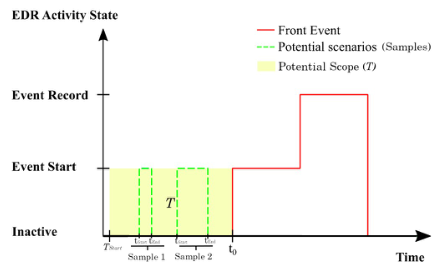

# Evolutionary Algorithm for EDR test samples

### Introduction
This algorithm was presented as a part in the thesis I wrote for my Master of Science (M.Sc.) degree in the “Automotive Software Engineering” program, whose main objective was to provide a testing methodology based on the ISO 26262 standard to address the new regulations taking effect in 2021 for EDRs and DSSADs within the framework of several markets around the world.  EDR (Event Data Recorder) and DSSAD (Data Storage System for Automated Driving) are devices installed in vehicles to record critical driving and crash dynamics data during an accident.

The proposed approach to create test samples assumes the discovery of a malfunction during a test.  Thereafter, it can be used to exploit the flaw, uncovering other related malfunctions, and narrowing down the scope and behavior of the error within the limits of the HiL test.

### Description
In the operation of an EDR, there are different triggers for activating and recording an event, these are defined in government resolutions.  The test under consideration examines whether an activation trigger might prevent the recording of an event, depending on the timing of each trigger.

If some errors are detected during a HiL test cycle for the case described above, the parameters of further tests can be optimized by this Evolutionary Algorithm (hereinafter referred to simply by the acronym **EA**).



*EDR test case for which the **EA** is made*

#### Population

A test set for this test case (**EA**'s output) is a collection of tuples setting the start and the end of the so called "trivial event" in the way
$$(t_{\text{start}}, t_{\text{End}})$$
where
* $t_{\text{start}} < t_{\text{End}}$ and $t_{\text{End}} \in T$
* $T = [T_{\text{Start}}, t_0]$: Pre-crash recording time established in the regulation. $t_0$ is the instant when the recording algorithm starts, normally set to zero.

All times are given in milliseconds.

#### Fitness Orientation

The optimization made by the **EA** works according to the principles of software testing "defect clustering" and "the Pesticide Paradox":
* Defect clustering: Most software bugs are concentrated within a small number of complex or heavily used modules.
* The Pesticide Paradox: Repeatedly running the same tests will eventually stop finding new bugs as the software evolves.

Then, the fitness function $f$ for a tuple $(t_{\text{start}}, t_{\text{End}})$ with respect to all *i*_tuples in $E$ is expressed as:
* $\displaystyle f=V_1 +c⋅V_2$, Where
* $\displaystyle V_1 = \frac{a \cdot \min\limits_{i \in E}\Big|t_{\text{start}} - E_i(t_{\text{start}})\Big| + b \cdot \min\limits_{j \in E}\Big|t_{\text{End}} - E_j(t_{\text{End}})\Big|}{1000}$
* $\displaystyle V_2 = \begin{cases} T_{\text{Start}} - t_{\text{End}} & \text{if } t_{\text{End}} < T_{\text{Start}} \\ 0 & \text{if } t_{\text{End}} \in T \\ t_{\text{End}} - t_0 & \text{if } t_{\text{End}} > t_0 \end{cases}$

The $V_1$ equation can be read as: "The distance from $t_{\text{start}}$ to the closest start time of any tuple in the captured malfunction's collection $E$, weighted by $a$, plus the distance from $t_{\text{End}}$ to the closest end time of any tuple in $E$, weighted by $b$, divided by 1000", where:

* $E$: Set of test samples that have led to find an error. Consequently, $E_i(t_{\text{start}})$ and $E_j(t_{\text{End}})$ are the first and second component of a tuple in the collection $E$.
* $t_{\text{Start}}$ and $t_{\text{End}}$ are chosen independently, so their closest values may come from different tuples in $E$. This allows the algorithm to search any combination of known start and end times, rather than requiring a proposed tuple to match a single known tuple.
* As the tuples are given in milliseconds, the weighted distance is divided by $1000$ so that the result can be managed in one digit.
* The end of the examined trivial event ($t_{\text{End}}$) is more important than its beginning ($t_{\text{Start}}$), therefore the equation prioritizes<br>$\min\limits_{j \in E}\Big|t_{\text{End}} - E_j(t_{\text{End}})\Big|$ over $\min\limits_{i \in E}\Big|t_{\text{start}} - E_i(t_{\text{start}})\Big|$. Thus $b$ must be accordingly higher than $a$ ($b>a$).
* If $E$ is empty, then $V_1=0$ consequently.

The $V_2$ equation scores lower the trivial events (*the tuples* $(t_{\text{start}}, t_{\text{End}})$) that end within the pre-crash recording time established by a market regulation, as the main purpose of the HiL test is to verify the functioning of an EDR device within the parameters established by a market regulation. If $t_{\text{End}}$ lies outside the pre-crash recording time $T$, the value of this function is the distance from $t_{\text{End}}$ to the nearest bound of $T$, that is, $\max(0,\ T_{\text{Start}} - t_{\text{End}},\ t_{\text{End}} - t_0)$.
Therefore:
* $c$ in $f$ function must be greater than $a$ and $b$, therefore: $c>b>a$

The best scored tuple $(t_{\text{start}}, t_{\text{End}})$ by function $f$ is the lowest scored.

#### Variation Drive
The **EA** uses the “Roulette wheel selection” (RWS) method for selection.
Then relative fitness value for a tuple $i$ is:

$$p_i = \frac{f_i^{-1}}{\displaystyle\sum_{i=1}^{\text{popsize}} f_i^{-1}}, \text{ where, } \sum_{i=1}^{\text{popsize}} p_i = 1$$

* *popsize*: (Population size) Is the number of samples created before its selection.
* As the best possible score in $f$ function tends to zero, the prior equation uses $f_i^{-1}$ instead of $f_i$.
* A score of exactly $0$ is replaced by a small minimum value (`mindestwert` $= 0.0001$) so that its reciprocal can be calculated.

Then the tuple $k$ will be selected when
$$\sum_{i=1}^{k-1} p_i \le \text{rand} < \sum_{i=1}^{k} p_i$$
* where $\text{rand}$ is a random number between [0,1] and the empty sum for $k=1$ is $0$.
* This is repeated $\lambda_{\text{new}}$ times, so $\lambda_{\text{new}}$ parent tuples are selected. The same tuple can be selected more than once.

#### Mutation
The **EA** does not use recombination: the selected parent tuples are mutated directly.
It uses “normal mutation”, which performs the mutation on each parameter $x_i$ of a tuple ($t_{\text{start}}$ and $t_{\text{End}}$) independently:
$$x_i = x_i + N(\mu, \sigma)$$
* The mutation is rounded to whole milliseconds.
* If a mutated tuple has $t_{\text{start}} > t_{\text{End}}$, both values are swapped.
* Duplicates are removed: a mutated tuple that is repeated within the new tuples, or that has already been tested (it is in $E$ or in any population so far), is discarded. Therefore a generation can add fewer than $\lambda_{\text{new}}$ new tuples.

#### Survivor Selection
The new generation is chosen with a $(\mu + \lambda)$ strategy: the current population and the mutated tuples are joined, and the *popsize* tuples with the lowest score $f$ are kept for the next iteration.

### Algorithm

1. **Random test samples creation (Step 1):** *popsize* random tuples are created with $t_{\text{start}} \le t_{\text{End}}$ within the pre-crash recording time $T$ extended by `offset` milliseconds on both sides. The random creation keeps exploring new values every time the test is executed.
2. **Test execution and following test sample creation (Step 2):** repeated `step_2_iterations` times:
   1. *Evaluation:* every tuple of the population is scored with $f$.
   2. *Offspring:* $\lambda_{\text{new}}$ parent tuples are selected by RWS.
   3. *Mutation:* the parents are mutated and duplicates are removed.
   4. *Mutated samples evaluation:* the new tuples are scored with $f$.
   5. *New generation:* the best *popsize* tuples of the population and the new tuples are kept.

The algorithm stops after a fixed number of iterations (`step_2_iterations`); there is no other termination criterion. The final population is the **EA**'s output: the next test set to run on the HiL.

### Parameters

All parameters are module variables in [Evolutionary_Algorithm.py](Evolutionary_Algorithm.py) and can be changed in the web app.

| Parameter | Default | Meaning |
|---|---|---|
| `T_Start` | -5000 | Start of the pre-crash recording time $T$ (ms) |
| `t_0` | 0 | End of the pre-crash recording time $T$ (ms) |
| `popsize` | 4 | Population size: number of test samples per generation |
| `lambda_new` | 2 | Number of new tuples generated in each iteration |
| `step_2_iterations` | 4 | Number of iterations of Step 2 |
| `offset` | 10 | Extension of $T$ on both sides for the random samples of Step 1 (ms) |
| `a` | 1 | Weight of the $t_{\text{start}}$ distance in $V_1$ |
| `b` | 3 | Weight of the $t_{\text{End}}$ distance in $V_1$ |
| `c` | 5 | Weight of $V_2$ in $f$ |
| `V_1_scale` | 0.001 | Scale factor of $V_1$ (the division by 1000) |
| `mu` | 0 | Mean of the normal mutation |
| `sigma` | 5 | Standard deviation of the normal mutation (ms) |
| `mindestwert` | 0.0001 | Replacement for a score of 0 in the RWS |
| `error_hit_set` | empty | $E$: the tuples that have found an error |

### How to run

Requirements: Python 3 (the [mise.toml](mise.toml) sets Python 3.13 and a `.venv`) and the packages in [requirements.txt](requirements.txt).

```sh
pip install -r requirements.txt
```

**Command line:** runs Step 1 with a fixed example population and then Step 2, and prints both populations.

```sh
python Evolutionary_Algorithm.py
```

**Web app:** a Streamlit interface to set all parameters and run the steps.

```sh
streamlit run WebApp/layout.py
```

1. Optionally enter the `error_hit_set`, one tuple per line in the format `t_Start, t_End` (e.g. `-4025, -300`), and press **Enter `error_hit_set`**.
2. Press **Create Random samples array (Step 1)**.
3. Press **Run Evolutionary Algorithm (Step 2)**. The resulting test samples are shown in the table below the button.
